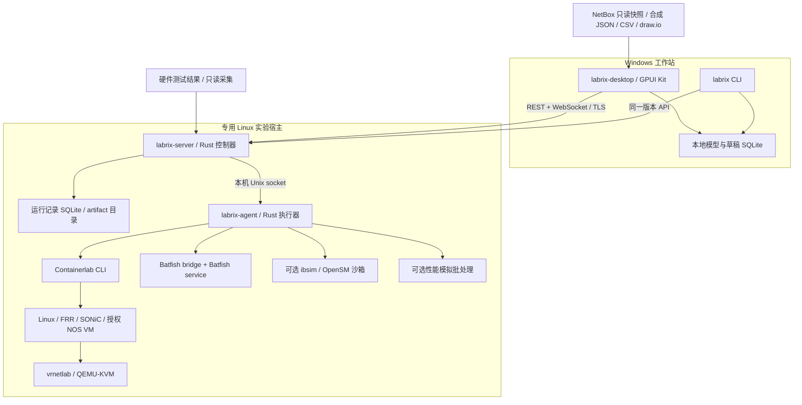
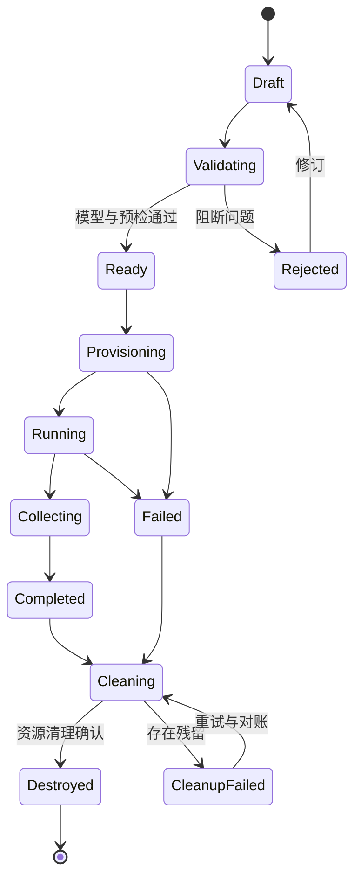

# Labrix 架构设计

日期：2026-11-01。状态：建议方案，接口与类型均未实现。

背景和选型依据：[最终调研](research.md)；实施及验证：[路线图](roadmap.md)。

## 1. 架构目标与约束

Labrix 为多 IDC GPU 基础设施提供一个统一的工作空间：物理结构和逻辑网络共用身份，多个后端按能力运行，结果按证据解释。第一版优先 Windows 桌面连接专用 Linux 实验机，单控制器、单运行 Agent 起步。

自有应用层采用 Rust。Containerlab、NOS、QEMU、Batfish、ibsim 等是外部执行组件，分别锁定版本。设计不要求把它们改写为 Rust，也不要求所有引擎共享一个仿真时钟。

首版不包含生产网络自动变更、完整 GPU / ASIC 仿真、热力 / 电力仿真、多人实时协同编辑、跨宿主分布式包转发和 Kubernetes 调度。领域模型可表达多个站点，但不等于第一版已实现分布式实验。

## 2. 部署与进程边界



桌面本地数据库保存草稿、布局和离线资产快照；服务端数据库保存提交后的不可变 revision、执行计划、run、事件及证据索引。二者通过显式提交同步，不做双向数据库复制。UI 关闭后服务端实验继续运行。

首版控制器和 Agent 可以作为同一安装包的两个进程，在单 Linux 主机上通过 Unix socket 通信。Agent 持有启动容器 / VM 所需权限，控制器和桌面不直接访问 Docker socket。未来扩展远程 Agent 时使用有身份校验的 TLS 通道与 capability 握手，按需增加调度。

Batfish 初版通过短小、固定版本的 pybatfish bridge 暴露 Labrix 所需的查询子集；桥接输出结构化结果。Containerlab 和 ibsim 使用参数数组启动子进程，禁止将用户字段拼成 shell 命令。

## 3. 领域模型：四种事实分别保存

| 模型 | 含义 | 更新规则 |
| --- | --- | --- |
| InventorySnapshot | 某时刻从 NetBox / 表格 / 人工记录获得的资产信息 | 不可变快照，保留来源及采集时间 |
| DesignRevision | 用户在 Labrix 规划的拓扑和意图 | 每次提交产生新 revision，可比较与撤销 |
| RuntimeObservation | 某次实验后端观测到的节点、接口和协议状态 | 绑定 run / backend / timestamp，不覆盖设计 |
| ValidationEvidence | 针对断言的输入、结果、输出片段、限制 | 绑定输入 hash 和工具版本，可追溯 |

建议工作流是“资产快照 → 规划分支 → 实验 → 结果审查”。首版 NetBox 导入只读；实验中一条链路 down 不应把 NetBox 资产端口改成故障，也不应悄悄修改规划图。

表格是人工维护入口之一，NetBox 是运营资产来源。冲突的设备身份、placement、serial、模块归属或接口信息进入 review item；不靠名称相似度自动合并。导入保留原文件，输出新的差异报告。

### 3.1 主要实体

| 实体 | 最小字段 / 关系 | 设计理由 |
| --- | --- | --- |
| Site / Rack | UUID、名称、可选位置、容量与来源 | 多 IDC 分组及机柜视图，不强制复杂资产字段 |
| DeviceInstance | profile_ref、site、rack、可选 placement、source_ref | 稳定身份独立于显示名称和 IP |
| DeviceProfile | 厂商、型号、硬件版本、槽位和端口规格、能力引用 | SKU 与 runtime image 分离 |
| ChassisComponent | parent、模块 / 内部交换设备 / NIC / GPU、槽位 | 一个机箱可包含多个独立交换实体 |
| Cage / Transceiver | 笼类型、模块规格、可用 lanes、速率组合 | 避免把 OSFP 笼等同单逻辑端口 |
| PhysicalPort | 所属组件、协议、速率集合、lane、breakout 关系 | 硬件端点和可用组合约束 |
| LogicalInterface | physical_port_ref、NOS 名、VLAN / LAG / L3 配置引用 | Ethernet0、eth1 等名称各属于具体命名空间 |
| Link / CableAssembly | 端点 / 分支、介质、长度可选、breakout 关系、source | 一根分叉线缆可对应多条逻辑链路 |
| Fabric / Plane / Rail | 协议、成员、故障域、用途 | Ethernet、IB、BMC、storage 和 GPU rail 分别表达 |
| Intent / Assertion | 目标流量、可达 / 不可达、路径 / 冗余预期、所需验证类型 | 结果以用户关心的行为呈现 |
| Scenario / Fault | 故障对象、触发点、持续时间、恢复步骤、清理策略 | 受控复现实验 |
| Run / Artifact | revision、plan hash、版本、时间、输出引用 | 复现与审计 |

一个物理端口不能在互斥 breakout 模式下重复使用；一个逻辑接口可关联 VLAN 子接口或 LAG，但不增加真实端口容量。缺失物理层信息允许 `unknown`，不能为了绘图完整自动填值。

机柜 position 的具体方向、占用高度和最低 U 位置必须在导入器中明确定义并转换；未知 placement 保持未知。设备 asset tag、序列号和内部组件标识使用不同字段。

### 3.2 三类链路速率

- `nominal_bps`：硬件或设计规格，例如 800G。
- `configured_bps`：实验中设置的 rate limit / 模型容量。
- `measurement`：某时间窗口、方法和方向下获得的实际速率。

双向容量、payload 带宽、端口线速和集合通信 bus bandwidth 使用不同指标名及单位；不能把它们直接混算。模型参数取设计 nominal 也必须在报告中说明。

### 3.3 能力模型是行为契约

能力键例如 `ethernet.vlan`、`routing.bgp`、`firewall.nat`、`ha.session_sync`、`ib.mad.discovery`、`gpu.nccl.measurement`。具体镜像与后端组合给出：

```json
{
  "profile": "synthetic-sonic-switch",
  "backend": "containerlab",
  "image_digest": "resolved-at-preflight",
  "capability": "ethernet.lacp",
  "support": "unverified",
  "evidence_kind": "nos-emulation",
  "restrictions": ["hardware ASIC behavior excluded"],
  "fixture_ref": null
}
```

这是接口示意，尚不是可运行 schema。`support` 建议枚举为 supported / partial / unsupported / unverified。supported 必须带 fixture 和版本范围；品牌级别的“支持 SONiC”不足以放行某个具体测试。

设备替代关系也要显式保存：physical_profile 为 Nexus 3524P，runtime_profile 为 N9Kv；报告说明验证的是其交集能力，不把 runtime_profile 反写成真实型号。

## 4. 编译流水线


每一步生成结构化诊断，引用具体实体、字段、严重性及修复提示。错误位置可从列表定位到画布端口。计划 hash 绑定 revision、后端版本、镜像 digest、能力清单和脚本模板版本；执行时发现变化应重新预检。

Containerlab YAML 是一个编译产物。设备物理端口、IB rail、故障域、证据需求等不能只放在 clab labels 中并期待第三方工具理解。导出时同时生成映射 manifest，记录 Labrix UUID 到节点、容器接口和 guest interface 的对应关系。

反向导入 clab / draw.io 时保留未知字段或 opaque metadata，并报告不能解析的元素。布局 round-trip 不等于设备行为 round-trip；缺失信息必须标记待确认。

## 5. 后端接口与计划

以下是概念接口，正式代码需要按首轮 PoC 调整，不承诺现有引擎提供相同 API。

| 操作 | 输入 | 输出 / 约束 |
| --- | --- | --- |
| discover | Agent 及引擎版本 | 可用能力、工具路径、KVM / 权限 / 资源 |
| plan | DesignRevision + 场景 + adapter config | 生成物、端点映射、预检、资源估算 |
| validate_plan | ExecutionPlan | 可执行性、镜像和许可引用是否满足 |
| create / start | run ID + plan hash + idempotency key | 后端句柄、状态、事件流 |
| observe | run ID + cursor | 增量事件、节点状态和指标引用 |
| execute_check | 受支持的 check ID + 参数 | 标准证据封套和原始输出引用 |
| inject_fault / revert_fault | 受支持 fault ID + 目标集合 | 实际生效对象、时间、恢复句柄 |
| stop / destroy | run ID + 已拥有资源清单 | 停止结果和可验证的残留资源报告 |
| reconcile | run ID + 上次确认状态 | 重启或连接中断后的实际状态对账 |

模型型后端不必实现真实 NOS 的 console；Batfish 不必实现 start_node。每个 adapter 声明支持哪些操作，不支持时明确返回 unsupported。

首版适配器：

1. **ModelChecker**：不需宿主特权，检查端口、协议、breakout、rail、冗余和资产冲突。
2. **ContainerlabAdapter**：生成 clab，执行 deploy / inspect / destroy，采集 guest 状态。
3. **BatfishAdapter**：生成快照，通过固定查询集合分析配置；先检查解析状态。
4. **IbsimAdapter**：通过门禁后启用，生成 fabric 文件，在隔离环境启动 SM / 诊断命令。
5. **PerformanceBatchAdapter**：后期统一输入摘要与结果封套，不统一所有模拟器内部格式。
6. **HardwareEvidenceImporter**：导入明确授权测试产生的 RDMA / NCCL 结果；不是生产变更接口。

注意 SONiC VM / FortiGate 等 guest 的 CLI 与 launcher 容器 shell 是不同执行位置。adapter 必须记录 `target_context`，按 SSH / console 等正确方式采集。Containerlab 官方也明确说明 SONiC VM 的 exec 在 launcher 容器中执行。[SONiC VM 文档](https://containerlab.dev/manual/kinds/sonic-vm/)

## 6. 生命周期、故障与恢复



用户取消可从预检之后进入停止 / 清理流程；不能把客户端超时当作后端操作已取消。Provisioning、Collecting、Cleaning 都有独立超时和幂等处理。断线后 UI 显示 observation stale，并通过 cursor 恢复事件，不能直接显示全部节点 down。

故障分清 link-down、node-stop、管理路径失联、路由配置改变和虚拟 netem 丢包。操作前固化目标列表，执行后记录真正受影响的资源。修改路由等配置型故障必须有恢复快照；恢复失败时 run 不能显示成功结束。

只允许清理当前 run 拥有的容器、网络、namespace、接口和目录。按 run 标签和实际资源 ID 对账，不依赖名称前缀模糊删除，不使用全局 Docker prune。

## 7. 断言与证据

一个断言分别记录：执行状态、判定、证据类型、适用范围和置信依据。建议判定为 **pass / fail / unknown / unsupported / error**，其中 error 是执行失败，fail 是运行成功但断言不成立。

```json
{
  "assertion_id": "synthetic-management-isolation",
  "verdict": "unknown",
  "reason_code": "PARSER_PARTIAL",
  "evidence_kind": "static-analysis",
  "topology_revision": "immutable-revision-id",
  "plan_hash": "hash-of-resolved-plan",
  "backend": {"name": "batfish", "version": "pinned-at-run"},
  "image_digests": [],
  "observed_at": "timestamp-recorded-by-agent",
  "artifacts": [],
  "limitations": ["relevant firewall statements were not modeled"]
}
```

该示例说明：Batfish 即使成功返回，也不能在相关配置解析不完整时把隔离测试算作通过。相同原则适用于 ping 未执行、guest 未就绪、IB 子网未形成和性能模型缺少校准数据。

证据包建议包含 manifest.json、输入摘要、脱敏配置、工具版本、命令参数的安全摘要、stdout / stderr 引用、pcap 引用和断言结果。原始 artifact 私有保存，生成公开报告时显式脱敏；脱敏内容与实际测试输入分别记录 hash，避免把脱敏 hash 冒充原输入 hash。

报告对每个断言展示：预期、观测、后端 / 版本、失败反例、覆盖限制、下一步。不能把“模型通过 + NOS 不支持”汇总成一个绿色成功标记。

## 8. 性能模型与真实环境如何对照

真实 NOS 实验使用墙钟，离散事件模型使用虚拟时钟，硬件采集有独立测量时间。首版仅通过版本化拓扑、工作负载和结果封套关联它们，避免未经校准的联邦实时仿真。

模型必须声明 workload、消息大小 / 分布、通信算法、节点数量、网络容量 / latency、拥塞控制、计算 profile、随机种子、引擎版本和参数来源。缺失真实 B300 / CX8 profile 时，只输出相对比较或敏感性区间，明确“尚未校准”。

校准先选一个小场景：真实 2–4 台 GPU 主机与对应链路，在相同软件 / 消息大小下测试，再用同一参数集预测留出的场景。误差由实测报告给出；未验证前不宣称统一误差阈值或硬件级准确率。[nccl-tests 的测试范围](https://github.com/NVIDIA/nccl-tests/blob/master/README.md)

## 9. 桌面交互与性能

工作台提供站点 / 平面导航、中央拓扑、属性 / 问题侧栏、底部配置 / 控制台 / 事件面板。物理图、逻辑图和运行状态共享实体 ID，但布局独立。

画布使用世界坐标与视口变换，分层绘制背景、机柜 / 分组、设备、端口、连线和状态。增量更新、视口裁剪、细节级别、文本缓存及空间命中索引比“每个端口都是复杂 UI 控件”更适合大图。

UI 输入变成领域 command；command 产生状态变更并进入撤销栈，实验事件使用另一条 append-only 流。实时状态更新不能污染设计撤销历史。批量移动 / 连线作为一个可撤销操作。

后台任务经消息通道送回 UI；慢 CLI、网络请求、布局和分析不阻塞渲染。隐藏面板或切换标签只改变订阅和绘制，不关闭后端实验、SSH 或 console 会话；显式断开才关闭会话。

MVP 优先支持打开外部终端及私有 Web 控制台。嵌入终端属于单独组件工程，需处理 VT 状态机、PTY、输出限流、滚屏、焦点、编码、重连和密钥生命周期。不要为了“全 Rust”承诺在首版重写终端引擎。

## 10. 拟议 Rust workspace

以下是未来代码组织方案，仓库目前未创建这些 crate。

```text
crates/
  labrix-model/          设备、端口、链路、意图、revision、schema
  labrix-validate/       结构、能力、故障域及资源检查
  labrix-compiler/       规范化模型到各后端计划
  labrix-runtime/        run 状态机、幂等、事件与恢复
  labrix-evidence/       证据封套、断言判定、脱敏与报告
  labrix-store/          SQLite 及 artifact 索引
  labrix-protocol/       API 与 Agent 消息类型及版本协商
  labrix-adapter-clab/   Containerlab 外部进程适配
  labrix-adapter-batfish/桥接协议，外部工具独立发布
  labrix-adapter-ibsim/  可选 IB 管理沙箱
  labrix-import/        NetBox、JSON、CSV、draw.io
  labrix-desktop/       GPUI Kit、画布与会话视图
  labrix-cli/           导入、检查、计划、运行、报告
  labrix-server/        API、持久化、任务协调
  labrix-agent/         Linux 特权执行边界
```

依赖方向为桌面 / CLI / adapter → 编译 / runtime → model，model 不依赖 GPUI、Docker 或操作系统。先以少量 crate 建立闭环，达到边界确有价值时再拆分，避免一次创建所有空模块。

## 11. 与实验运行直接相关的权限设计

- 宿主预检同时查看模型地址和宿主 route / Docker 网络，发现重叠即阻断或重新分配；不假设默认实验网段总是可用。
- 第一版使用专用实验宿主；production uplink / host / macvlan 等接入由独立 profile 显式开放，普通拓扑不能任意绑定宿主接口。
- UI / API 身份、Agent 身份、设备凭据分开；秘密通过引用在执行节点解析，日志和证据生成前执行脱敏。
- 上传路径、模板和 artifact 引用限制在 run workspace，限制文件大小、进程输出与超时，防止非预期文件读取和资源失控。
- console 数据通过已授权 run 和节点映射访问，不接受任意宿主命令字符串。Labrix 不暴露通用 root shell API。
- 镜像摘要、启动参数、挂载、权限和网络连接写入计划；用户能在运行前审查具体资源和行为。

## 12. 关键架构决策

| 决策 | 采用原因 | 重新评估触发点 |
| --- | --- | --- |
| Rust 自有代码 + 外部引擎 | 保留真实 NOS 和成熟分析能力 | 有明确且验证过的 Rust 引擎能替代特定后端 |
| GPUI Kit 条件采用 | 密集原生工作台、统一语言 | Windows / RDP / 大图 / 输入法门禁未通过 |
| Labrix 自有中间模型 | 同时表达物理、IB、逻辑与证据 | 不因单一后端格式调整而推翻核心模型 |
| 单宿主 / 单控制器起步 | 降低调度与网络复杂度 | 测量证实资源或多人隔离需要多宿主 |
| NetBox 只读输入 | 避免实验状态污染运营资产 | 用户明确需要带审查的资产回写工作流 |
| 无自动生产变更 | 先形成可信实验闭环 | 独立设计生产变更、审批、回滚及验证功能 |
| 性能模型批处理隔离 | 时钟与精度边界清楚 | 研究证明联邦仿真必要且可校准 |

这些决策形成当前建议基线；正式实现前优先执行路线图中的风险验证，而不是将所有可选后端同时接入。
